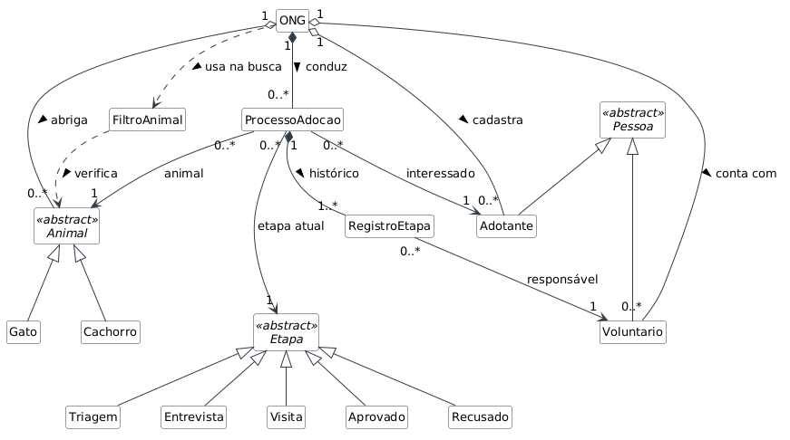

# Sistema de Gestão de Adoções para ONGs de Proteção Animal

# Trabalho Final – Programação Orientada a Objetos

## Equipe

| Nome | RA |
|---|---|
| Vitor Eduardo Bueno de Oliveira | 2764334 |
| Michael Pariz Pereira | 2321653 |
| Yves Ferreira Cardozo | 2703807 |

Linguagem: Python 3

## 1. Sobre o projeto

Sistema desenvolvido em Python para auxiliar ONGs de proteção animal no gerenciamento de animais disponíveis para adoção, cadastro de adotantes, voluntários e acompanhamento de processos de adoção.

## 2. Como executar

Requisito: Python 3 instalado.

```
python main.py
```

## 3. Funcionalidades
- Cadastro de cachorros e gatos.
- Cadastro de adotantes e voluntários.
- Consulta de animais disponíveis.
- Busca com filtros por espécie, porte, vacinação e castração.
- Abertura e acompanhamento de processos de adoção.
- Aprovação ou recusa de processos.
- Consulta do histórico de adoção.

## 4. Documentação

- Sprint 1: [proposta e diagrama inicial](Sprint1_Proposta_e_Modelagem.pdf)
- Sprint 2: diagrama de classes atualizado conforme a implementação ([PNG](diagrama_classes_sprint2.png) e [código PlantUML](diagrama_classes_sprint2.puml))

Mudanças no diagrama em relação à Sprint 1:
- `Cao` passou a se chamar `Cachorro` e `EtapaProcesso` passou a se chamar `Etapa`, para ficar igual ao código.
- A classe `Moradia` foi removida: por enquanto a moradia do adotante é só o tipo (casa ou apartamento), então virou um atributo de `Adotante`.
- A multiplicidade de `ONG` para `Voluntario` passou de `1..*` para `0..*`, porque a ONG começa sem voluntários cadastrados.
- Foi acrescentada a dependência `FiltroAnimal ..> Animal`, porque o filtro recebe o animal como parâmetro para verificar se ele atende aos critérios.


