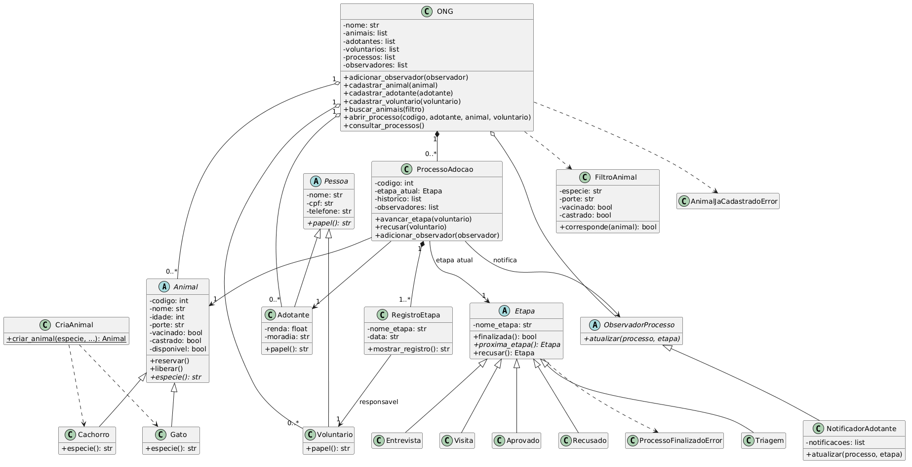

# Sistema de Gestão de Adoções para ONGs de Proteção Animal

# Trabalho Final – Programação Orientada a Objetos

## Equipe

| Nome | RA |
|---|---|
| Vitor Eduardo Bueno de Oliveira | 2764334 |
| Michael Pariz Pereira | 2321653 |
| Yves Ferreira Cardozo | 2703807 |

Linguagem: Python 3 (interface gráfica em Tkinter)

## 1. Sobre o projeto

Sistema desenvolvido em Python para auxiliar ONGs de proteção animal no gerenciamento de animais disponíveis para adoção, cadastro de adotantes, voluntários e acompanhamento de processos de adoção.

## 2. Como executar

Requisito: Python 3 instalado (no Linux, o Tkinter pode precisar de `sudo apt install python3-tk`).

```
python main.py       (versão em linha de comando)
python main_gui.py   (interface gráfica)
```

Os dois programas devem ser executados a partir da pasta raiz do projeto e usam as mesmas classes da pasta `logica`.

## 3. Estrutura do projeto

```
logica/        regras de negócio (classes de domínio)
gui/           interface gráfica em Tkinter
main.py        versão em linha de comando
main_gui.py    abre a interface gráfica
```

## 4. Funcionalidades
- Cadastro de cachorros e gatos.
- Cadastro de adotantes e voluntários.
- Consulta de animais disponíveis.
- Busca com filtros por espécie, porte, vacinação e castração.
- Abertura e acompanhamento de processos de adoção.
- Aprovação ou recusa de processos.
- Consulta do histórico de adoção.
- Notificações ao adotante a cada mudança de etapa do processo.

## 5. Padrões de projeto e exceções

- **Factory** (`logica/criarAnimal.py`): a classe `CriaAnimal` decide se cria um `Cachorro` ou um `Gato`, então uma espécie nova só exige mudança em um lugar.
- **State** (`logica/etapaProcesso.py` e `logica/processo.py`): cada etapa do processo é uma classe que decide se pode avançar ou ser recusada; o `ProcessoAdocao` só delega para a etapa atual.
- **Observer** (`logica/observer.py`): o `ProcessoAdocao` avisa os observadores a cada mudança de etapa, e o `NotificadorAdotante` guarda os avisos mostrados na interface.
- **Exceções personalizadas** (`logica/excecoes.py`): `AnimalJaCadastradoError` (código de animal repetido) e `ProcessoFinalizadoError` (avançar ou recusar um processo já aprovado ou recusado).

## 6. Documentação

- Sprint 1: [proposta e diagrama inicial](Sprint1_Proposta_e_Modelagem.pdf)
- Sprint 2: diagrama de classes atualizado conforme a implementação ([PNG](diagrama_classes_sprint2.png) e [código PlantUML](diagrama_classes_sprint2.puml))
- Sprint 3: interface gráfica e separação do código nas pastas `logica` e `gui`
- Sprint 4: [documentação final](Documentacao_Final_POO.pdf) e diagrama de classes completo, com atributos, métodos e relações ([PNG](diagrama_classes_sprint4.png) e [código PlantUML](diagrama_classes_sprint4.puml))

Mudanças no diagrama da Sprint 2 em relação à Sprint 1:
- `Cao` passou a se chamar `Cachorro` e `EtapaProcesso` passou a se chamar `Etapa`, para ficar igual ao código.
- A classe `Moradia` foi removida: por enquanto a moradia do adotante é só o tipo (casa ou apartamento), então virou um atributo de `Adotante`.
- A multiplicidade de `ONG` para `Voluntario` passou de `1..*` para `0..*`, porque a ONG começa sem voluntários cadastrados.
- Foi acrescentada a dependência `FiltroAnimal ..> Animal`, porque o filtro recebe o animal como parâmetro para verificar se ele atende aos critérios.

Mudanças no diagrama da Sprint 4:
- Inclusão de atributos e métodos em todas as classes.
- Novas classes dos padrões de projeto: `CriaAnimal`, `ObservadorProcesso` e `NotificadorAdotante`.
- Novas exceções `AnimalJaCadastradoError` e `ProcessoFinalizadoError`.


